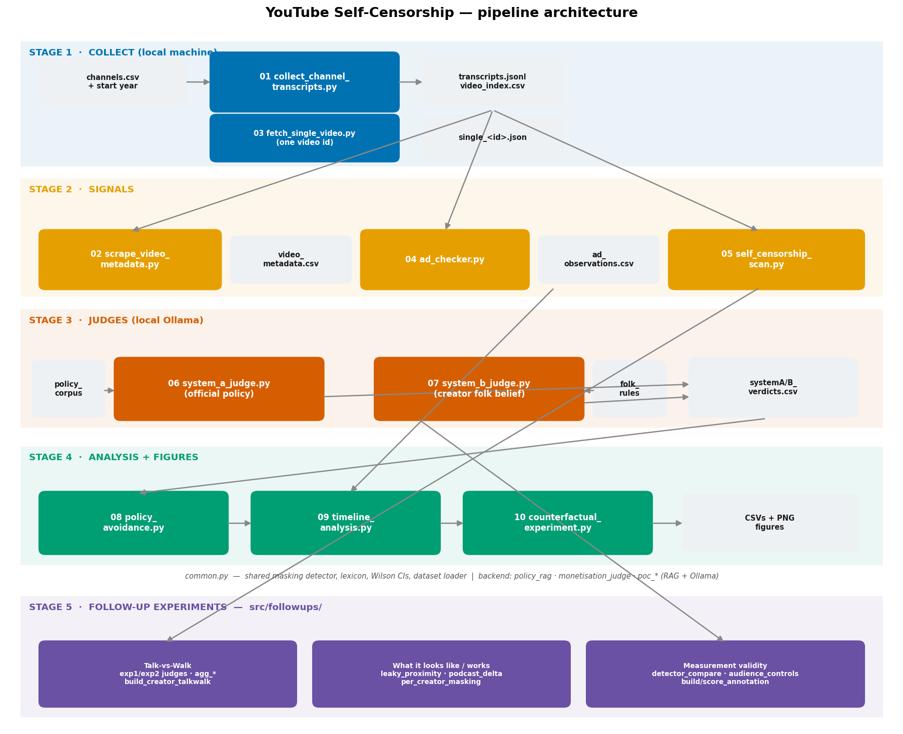

# Investigating YouTube Self-Censorship

Do YouTube creators censor themselves for rules that do not actually exist?

This project measures the gap between **what YouTube's monetisation policy really
says** and **what creators *believe* it says** — and shows that a large amount of
on-screen self-censorship (bleeping words, "unalive" instead of "kill", "grape"
instead of "rape") is aimed at a rule the platform does not enforce.

It collects creator transcripts, detects self-censorship deterministically, checks
whether videos are *actually* monetised, and runs two LLM "judges" over the same
videos — **System A** grounded in the official written policy, **System B**
simulating creator folk-belief. Where B is stricter than A, the self-censorship is
**misdirected**.

---

## Why this project is useful

- **It separates rules from rumour.** Most writing on demonetisation repeats
  creator lore. This pipeline puts the *written policy* and the *folk theory* side
  by side on the same videos and measures the distance between them.
- **Its self-censorship detector is deterministic (~100% precision).** Masking is
  found by regex, not a model, so results are reproducible and explainable.
- **It respects an honest evidence rule.** An ad *present* proves a video is
  monetised; an ad *absent* proves nothing. The code only ever treats "ads
  present" as ground truth, never the reverse.
- **Headline result** (reproducible from bundled data, see Quick start): of videos
  that are *literally serving ads*, creator folk-belief flags **76%** as
  "would be demonetised" while the written policy implies only **17%**.

---

## Architecture



The pipeline has four stages. Each numbered script is one module; `common.py` holds
the shared masking detector, euphemism lexicon, dataset loader, and statistics, so
every analysis counts things the same way.

| Stage | Scripts | What happens |
|-------|---------|--------------|
| **1 Collect** (local) | `01` transcripts, `03` single video | download captions + metadata from YouTube |
| **2 Signals** | `02` metadata, `04` ad checker, `05` self-censorship | turn videos into measurable signals |
| **3 Judges** (GPU) | `06` System A, `07` System B | policy-vs-belief verdicts via Ollama |
| **4 Analysis** | `08` misdirection, `09` timeline, `10` counterfactual | the results + figures |

---

## Requirements

- **Python 3.9+** (tested on 3.11)
- `pip install -r requirements.txt` → `yt-dlp`, `numpy`, `matplotlib`
- **Collection (Stages 1–3) needs no cookies** — the collectors use the YouTube
  android + web player clients, which expose caption tracks without a login.
- **Optional:** the ad checker (Stage 4) and metadata scraper (Stage 2) can use an
  exported `cookies.txt` at `data/www.youtube.com_cookies.txt` to reduce
  throttling, but it is not required. It stays on your machine and is git-ignored.
- **For Stages 6–7 (the judges) only:** an [Ollama](https://ollama.com) server with
  `qwen3:8b` and `nomic-embed-text` pulled. In this project it runs on a university
  GPU server; point the scripts at it with `--host` or the `OLLAMA_HOST` env var.
  The judges are not needed to reproduce the headline figures — their output is
  bundled.

---

## Quick start (runs on default settings, no network, ~10 seconds)

The repo ships a sample dataset and the pre-computed judge output, so the three
result scripts reproduce the project's headline numbers immediately:

```bash
pip install -r requirements.txt

python src/08_policy_avoidance.py        # misdirection: 76% folk vs 17% policy
python src/10_counterfactual_experiment.py   # algospeak backfires; disclaimer helps
python src/05_self_censorship_scan.py    # masking rate + "leaky mask" test
python src/09_timeline_analysis.py       # self-censorship over time
```

Each writes a `.csv` and a `.png` into `outputs/`. Expected console output:

```
A_policy_flags_demonetise_on_monetised_pct           16.8
B_folk_flags_demonetise_on_monetised_pct             76.2
```

---

## Advanced usage

Every script takes `--help`. Common adjustments:

**Stage 1 — collect transcripts for your own channels**
```bash
# channels.csv has two columns: channel,url
python src/01_collect_channel_transcripts.py --channels data/sample_channels.csv \
       --since-year 2021 --cap 50
#   --since-year  keep only uploads from this year on (prompted if omitted)
#   --cap         max videos sampled per channel, spread across its history
```

**Stage 1 (server) — same collection on a remote GPU server (no cookies)**
```bash
# channels JSON is a list of {channel,category,url}; runs detached in tmux
CAP=150 python src/01b_collect_channel_transcripts_server.py \
       data/sample_channels_server.json seen_ids.txt > out.jsonl
#   env CAP     videos per channel
#   arg 2       optional file of already-collected ids to skip (additive re-runs)
```

**Stage 2 — engagement metadata / ad presence**
```bash
python src/02_scrape_video_metadata.py --index outputs/video_index.csv --comments 20
#   --comments N  also save N top comments per video (slower)

python src/04_ad_checker.py --input outputs/video_index.csv --region US
python src/04_ad_checker.py dQw4w9WgXcQ          # or a single id
```

**Stage 3 — single video into the label set**
```bash
python src/03_fetch_single_video.py <video_id>   # pull transcript + details to confirm a label
```

**Stage 3 — the judges (need Ollama)**
```bash
# runs on the GPU server; qwen3:8b, temperature 0
export OLLAMA_HOST=http://localhost:11434
python src/06_system_a_judge.py --from-csv data/ground_truth_labels.csv --limit 10
python src/07_system_b_judge.py --from-csv data/ground_truth_labels.csv --limit 10
#   --video-id <id>   judge one video
#   --host URL        point at a remote Ollama
#   -k 5              policy sections to retrieve (System A)
```

**Stage 4 — analysis knobs**
```bash
python src/09_timeline_analysis.py --category true-crime --min-n 5
#   --category   restrict to one content category (removes the composition confound)
#   --corpus     use a different dated JSONL transcript file
#   --min-n      minimum videos per quarter before a point is plotted
```

---

## Module by module (inputs → outputs)

| # | File | Input | Output |
|---|------|-------|--------|
| 1 | `01_collect_channel_transcripts.py` | `channels.csv` + start year | `transcripts.jsonl`, `video_index.csv` |
| 1b | `01b_collect_channel_transcripts_server.py` | channels JSON + optional seen-ids | `transcripts.jsonl` (server variant: no cookies, android client, category tags) |
| 2 | `02_scrape_video_metadata.py` | `video_index.csv` | `video_metadata.csv` (views/likes/tags…) |
| 3 | `03_fetch_single_video.py` | one video id | `single_<id>.json` |
| 4 | `04_ad_checker.py` | video ids | `ad_observations.csv` (ad_config 0/1) |
| 5 | `05_self_censorship_scan.py` | dataset transcripts | masking hits + leak-rate + figure |
| 6 | `06_system_a_judge.py` | transcript + `policy_corpus/` | `system_a_verdicts.csv` |
| 7 | `07_system_b_judge.py` | transcript + `folk_corpus/` | `system_b_verdicts.csv` |
| 8 | `08_policy_avoidance.py` | A + B + ad signals | misdirection table + figure |
| 9 | `09_timeline_analysis.py` | dated transcripts | quarterly masking timeline + figure |
| 10 | `10_counterfactual_experiment.py` | 60 clips × 3 versions | counterfactual table + figure |
| — | `common.py` | — | shared detector, lexicon, Wilson CIs, loader |
| — | `policy_rag.py`, `monetisation_judge.py`, `poc_*.py` | — | RAG + Ollama backend for the judges |

---

## Repository layout

```
amrita-review/
├── README.md
├── requirements.txt
├── docs/
│   ├── architecture.png          # block diagram (gen_architecture.py rebuilds it)
│   └── gen_architecture.py
├── src/                          # the 10 pipeline scripts + shared backend
│   ├── 01..10_*.py
│   ├── common.py
│   └── policy_rag.py, monetisation_judge.py, poc_*.py
├── data/
│   ├── dataset/<creator>/*.json  # sample transcript corpus (538 videos)
│   ├── euph_transcripts.jsonl    # 1,189 dated transcripts (timeline)
│   ├── policy_corpus/            # System A knowledge (YouTube guidelines + index)
│   ├── folk_corpus/              # System B knowledge (creator folk rules)
│   ├── ground_truth_labels.csv   # creator-confirmed monetised/demonetised labels
│   ├── 05_1000videos_ad_systemA_systemB.csv   # precomputed A/B/ad (for Stage 8)
│   ├── counterfactual_judge_output.jsonl      # precomputed (for Stage 10)
│   └── sample_channels.csv
└── outputs/                      # generated CSVs + figures (git-ignored)
```

---

## Data & ethics note

All transcripts and metadata are public YouTube data. The folk-theory corpus is
mined from public creator discussion archives (the Arctic Shift archive, since the
Reddit API is restricted). No private data is collected. The `ground_truth_labels`
are the author's manual monetised/demonetised confirmations.
